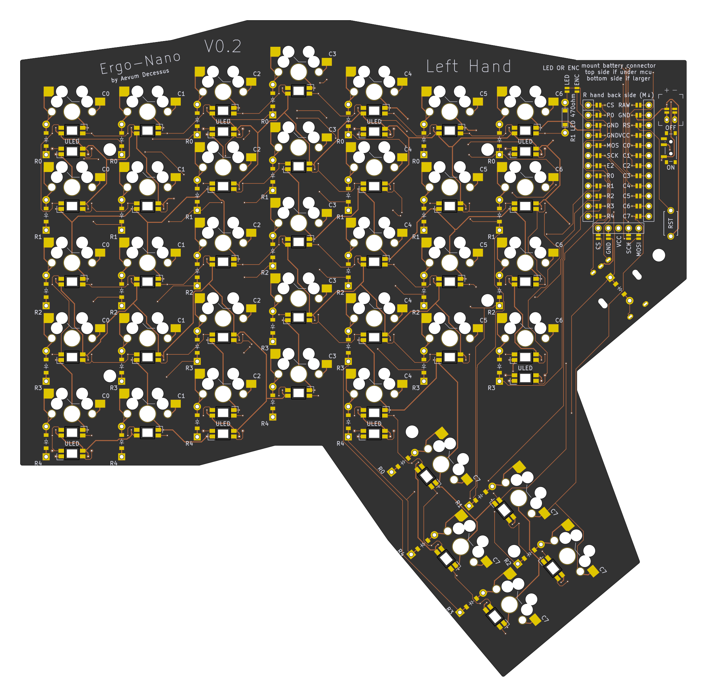
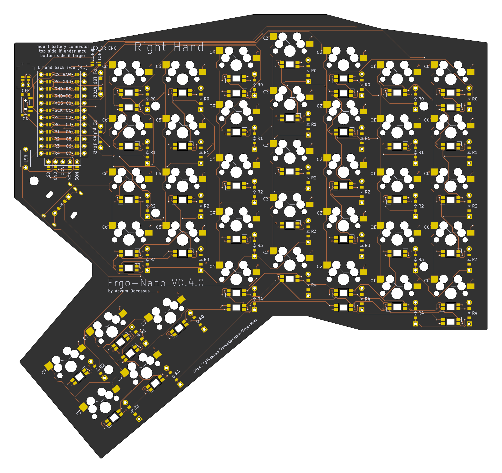

# Ergo-Nano keyboard design

A ergodox/moonlander inspired wireless-first split keyboard design, defined in code with [Ergogen][ergogen].

Utilizes the [nice!nano][nice-nano] for a wireless-first methodology. The wireless firmware is built on [ZMK][zmk].

[Changelog](./CHANGELOG.md)

## Important notes

This layout is fully generated, and as of the V0.1 release HAS NOT BEEN BUILT OR TESTED YET. Feel free to use this as a reference, but you are making this at your own risk until it has been build, tested, and vetted.

## Layout

Replaced all the 1.5U keys with 1U keys on the farthest outside rows, moved the thumb cluster closer to the natural thumb resting location, a major complaint with the Ergodox.

Each half is a 5x6 matrix with 5 thumb keys, and the modifier keys removed from the innermost 2 columns.

Built with MX keysizes be default.

### Optional Jumpers

2 optional jumpers are located to the left of the MCU to choose between per-key and underglow LEDS, or the rotatry encoder located below the main board. Connect the one you would like with a solder bridge in order to enable pin `P0` to connect to either the led chain `din`, or to one of the encoder's rotary pins (the other is connected to the pin labeled `E2`)

### Hardware requirements

#### Required hardware (per side)

- [nice!nano][nice-nano]
- 38 MX comaptible switches per side
- 38 [Kailh hotswap sockets][hotswap-socket]
- 38-39 SOD-123 (SMD) or 1N4148 (THT) Diodes (1 extra for optional encoder)
- 37-39 1U MX compatible keycaps
  - optional 1.5U vertical keycap for the top of the thumb cluster
  - optional 1U switch in place of optional encoder
- [JST-PH socket][jst]
- [Power Switch][power]
- Battery
  - [Fits under MCU][battery-small] - not recommended with LEDs
  - Larger 3.7V batteries

#### Optional Hardware (per side)

- [nice!view][nice-view]
- Lights
  - 38 [Per Key LED][LED] SK-6812 MINI-E
  - 9 [Underglow LED][LED] SK-6812 MINI-E
  - 470 ohm 1206 SMD or THT resistor (protect LED data line)
  - 10k ohm 1206 SMD or THT resistor (pull up resistor to make sure LEDs are powered off unless specifically requested)
  - AO3401 SOT-23 P-type mosfet (makes sures LEDs have no phantom power draw)
- EC11 Encoder

## Contents

Case STLs:

- [Bottom Case PCB](cases/bottom_case_pcb.stl) 3d Printable case with walls that sit flush with the top of the PCB
- [Bottom Case Switch](cases/bottom_case_switch.stl) 3D Printable case that sits flush with the top of the switchplate
- [Deep Bottom Case](cases/bottom_case_Deep.stl) Deep bottom case to accomodate larger batteries for longer lifetime

Plates:

- [Backplate](outlines/backplate.dxf) DXF to cut your own backplate out of acrylic/wood/etc
- [Backplate PCB](gerbers/backplate.zip) Gerber release to get a backplate manufactured out of PCB
- [Switchplate](outlines/switchplate.dxf) DXF to cut your own switchplate out of acrylic/wood/etc
- [Switchplate PCB](gerbers/switchplate.zip) Gerber release to get a switchplate manufactured out of PCB

## Images

### Top (Left Hand)

### Bottom (Right Hand)

[battery-small]: https://typeractive.xyz/products/lithium-battery-110mah
[ergogen]: https://github.com/ergogen/ergogen
[hotswap-socket]: [https://typeractive.xyz/products/hotswap-sockets]
[jst]: https://typeractive.xyz/products/battery-jack
[LED]: https://keeb.io/products/sk-6812-mini-e-rgb-leds-12-pack
[nice-nano]: https://nicekeyboards.com/nice-nano/
[nice-view]: https://nicekeyboards.com/nice-view/
[power]: https://typeractive.xyz/products/power-switch
[zmk]: https://zmk.dev/
